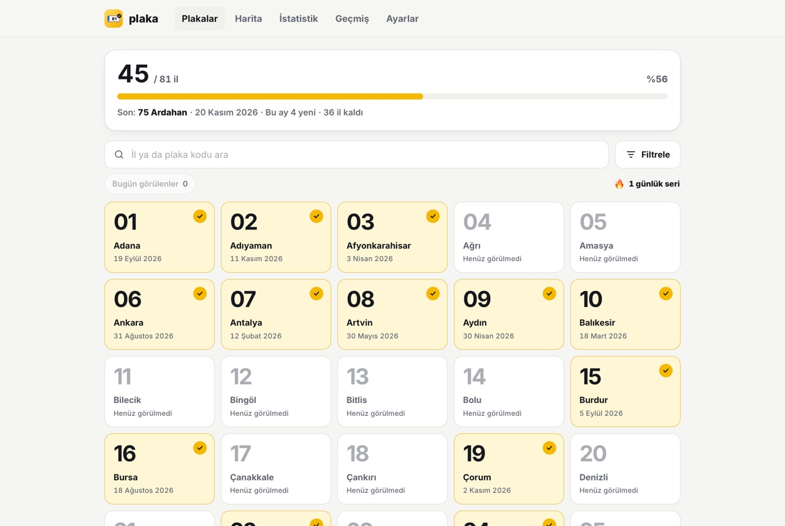
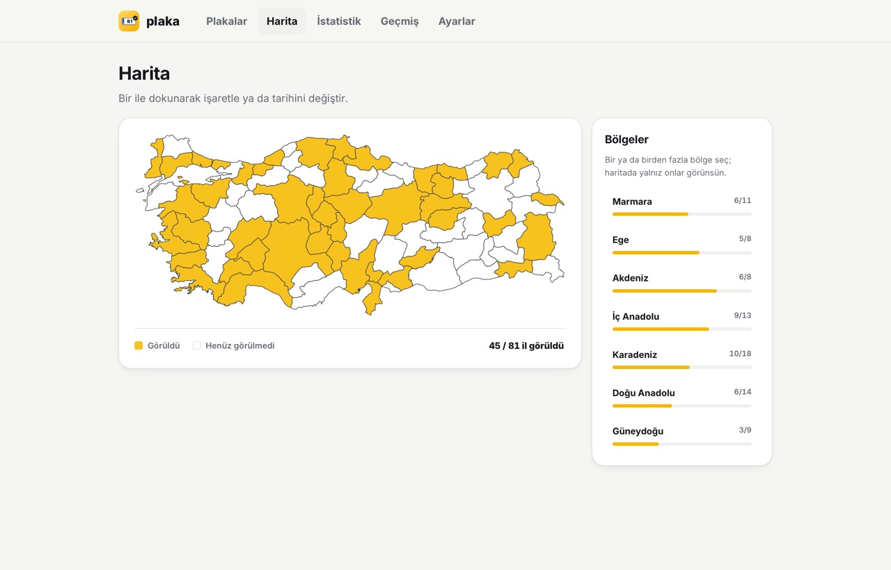
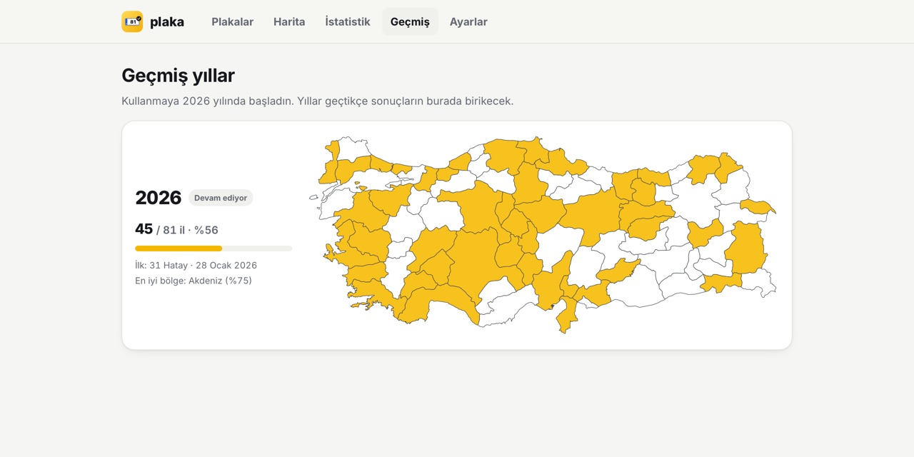
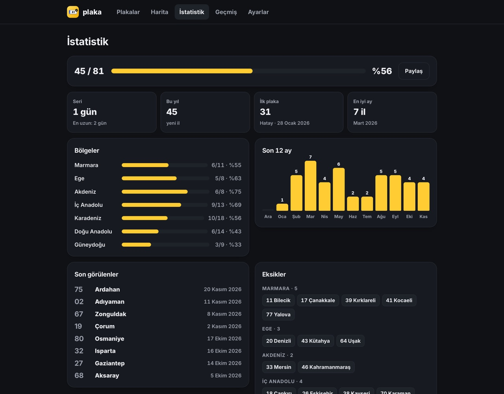
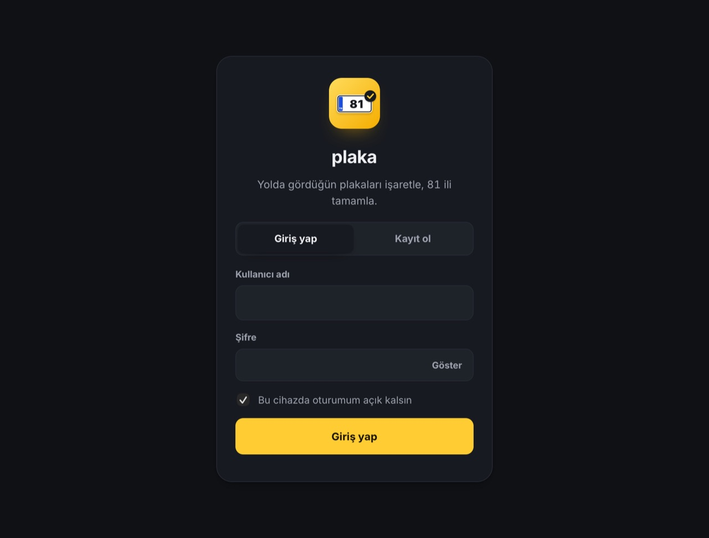
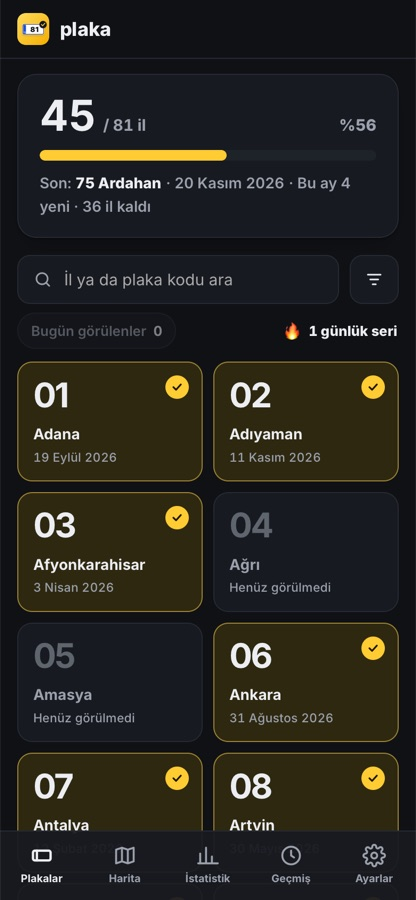
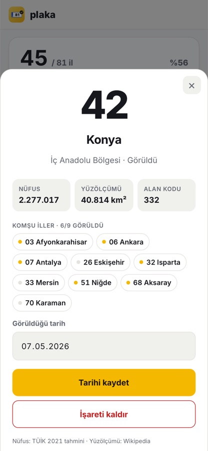

# plaka

Yolda gördüğün plakaları işaretleyip Türkiye'nin **81 ilini** tamamlamaya çalıştığın bir web uygulaması.
Her ilin kendi plaka kodu var (01 Adana … 81 Düzce). Amaç hepsini görmek. İlerlemen hesabına kaydedilir,
telefonda ve bilgisayarda aynı liste görünür, internet yokken de çalışır.



## Özellikler

**İşaretleme**
- **Dokun ve işaretle:** Plakaya dokununca bugünün tarihiyle işaretlenir; yanlışlıkla olursa "Geri al".
- **Basılı tut:** Tarih değiştirme ve il ayrıntıları penceresi açılır (bilgisayarda sağ tık).
- **Arama ve filtre:** İl adı ya da plaka koduyla arama; Görülenler / Eksikler / Bugün görülenler; bölge ve sıralama.
- **İl bilgisi:** Nüfus, yüzölçümü, telefon alan kodu ve komşu iller (komşulardan hangilerini gördüğünle birlikte).

**İlerleme ve motivasyon**
- **Harita:** İl sınırları belirgin Türkiye haritası. Bir ya da birden fazla bölge seçip yalnız onları gösterebilirsin.
- **İstatistik:** Genel ilerleme, bölgelere göre yüzdeler, son 12 ay, son görülenler, eksik iller, seri (art arda kaç gün yeni il).
- **Kutlamalar:** %25, %50 ve %75'te ("81 ilin 21'ini gördün") ve bir bölge tamamlanınca konfeti ve kısa ses efektleri.
- **Paylaşım kartı:** Haritan ve sayınla paylaşılabilir bir görsel.

**Yıllar**
- **Her yıl sıfırdan başla:** İstersen her yıl 81 ile yeniden başlarsın; eski yılların sonuçları silinmez.
- **Geçmiş sekmesi:** Kullanmaya başladığın yıldan bu yana her yılın haritası ve sonucu.

**Güvenilirlik**
- **Akıllı eşitleme:** Cihazlar bütün listeyi değil yalnız yaptıkları değişikliği gönderir. Sunucu bunları il il ve sırayla
  birleştirir; telefonla bilgisayar aynı anda kullanılsa da birbirinin işaretini silmez.
- **Çevrimdışı çalışma:** İnternet yokken yapılan işaretler cihazda bekletilir, bağlantı gelince kendiliğinden kaydedilir.
- **Telefona yükleme:** Ana ekrana eklenip uygulama gibi açılır.

**Hesap ve gizlilik**
- Yalnız kullanıcı adı ve şifre; e-posta ya da başka kişisel bilgi istenmez.
- Şifre değiştirme, verini indirme / yedekten yükleme, tüm işaretleri sıfırlama ve hesabı kalıcı silme.
- Yönetici paneli: kullanım özeti, kullanıcı listesi, şifresini unutana geçici şifre.

## Ekran görüntüleri

| Harita | Geçmiş yıllar |
| --- | --- |
|  |  |

| İstatistik | Giriş |
| --- | --- |
|  |  |

| Telefonda plakalar | İl ayrıntıları |
| --- | --- |
|  |  |

*Ekran görüntüleri örnek verilerle alınmıştır; gerçek kullanıcı verisi içermez.*

## Güvenlik

- Şifreler **bcrypt** ile saklanır; oturumlar **JWT** ile (7 gün) ve ortam değişkenindeki gizli anahtarla imzalanır.
- Giriş ve kayıtta **ziyaretçi başına deneme sınırı** (15 dakikada 10) ve **10 yanlış şifrede 15 dakika hesap kilidi**.
  Hata mesajları ve yanıt süreleri, kullanıcı adının var olup olmadığını belli etmez.
- Yönetici yetkisine **sunucu** karar verir (`ADMIN_USERNAME`); yönetici kendi hesabını silemez.
- Kullanıcı verisi sayfaya HTML olarak değil düz metin olarak yazılır (XSS'e karşı); kullanıcı adları kısıtlıdır.
- Yalnız `public/` klasörü sunulur. Kaynak kod, veritabanı ve `.env` HTTP'den erişilemez; Docker imajına ve bu depoya girmez.
- Dış kaynaktan içerik yüklenmez: yazı tipi, harita ve simgeler uygulamanın içinde barındırılır.

## Teknolojiler

JavaScript · Node.js · Express · SQLite · JWT · bcrypt · node-cron · Helmet · Service Worker · Docker

## Kendin çalıştır

Gerekenler: Docker ve Docker Compose (ya da Node.js 22+).

```bash
cp .env.example .env      # değerleri doldur
touch veritabani.sqlite   # veritabanı dosyası, konteynere bağlanır
mkdir -p yedekler         # gecelik yedekler buraya yazılır
docker compose up -d --build
```

Uygulama `127.0.0.1:3000` üzerinde çalışır; yayına almak için önüne bir ters vekil (reverse proxy) ya da
tünel (ör. Cloudflare Tunnel) koy. Ayarlar (`.env`):

| Değişken | Açıklama |
| --- | --- |
| `SECRET_KEY` | Oturumları imzalayan uzun, rastgele metin (en az 32 karakter). Yoksa uygulama başlamaz. |
| `ADMIN_USERNAME` | Yönetici paneline girebilecek hesap. |
| `ALLOWED_ORIGIN` | İsteğe bağlı. Uygulamaya başka bir adresten de erişilecekse o adres (CORS için). Uygulamanın kendi adresi her zaman kabul edilir. |
| `TRUST_CLOUDFLARE` | Uygulama Cloudflare (ör. Cloudflare Tunnel) arkasındaysa `true`; deneme sınırı ziyaretçi adresini Cloudflare'den alır. Değilse boş bırak. |
| `BACKUP_DIR` | Gecelik yedek klasörü (varsayılan `yedekler/`). |
| `BACKUP_KEEP_DAYS` | Yedeklerin kaç gün saklanacağı (varsayılan `14`). |
| `PORT` | Varsayılan `3000`. |

## API

| Yöntem | Yol | Açıklama |
| --- | --- | --- |
| `POST` | `/api/register` | Hesap aç, oturum anahtarı al. |
| `POST` | `/api/login` | Kullanıcı adı ve şifreyle giriş. |
| `GET` | `/api/me` | Oturumdaki kullanıcı ve yönetici bilgisi. |
| `DELETE` | `/api/me` | Kendi hesabını ve verini sil (şifreyle). |
| `GET` | `/api/plates` | İşaretler: tüm zamanlar, yıllara göre geçmiş, başlangıç yılı. |
| `POST` | `/api/plates/ops` | Değişiklikleri gönder: `set` (işaretle), `del` (bir yıldan kaldır), `delAll` (tamamen kaldır). |
| `POST` | `/api/settings` | Şifre değiştir (mevcut şifre gerekir). |
| `GET` | `/api/admin/summary` | Yönetici: kullanım özeti. |
| `GET` / `DELETE` | `/api/admin/users[/:id]` | Yönetici: kullanıcıları listele / sil. |
| `POST` | `/api/admin/users/:id/password` | Yönetici: geçici şifre oluştur. |

## Proje yapısı

```
server.js                     Express sunucusu: API, hesaplar, eşitleme, yönetici, gecelik yedek
public/index.html             Uygulamanın sayfası
public/sw.js                  Çevrimdışı çalışma için servis çalışanı
public/assets/app.js          Uygulamanın davranışı
public/assets/app.css         Tasarım
public/assets/turkiye.svg     Türkiye il haritası
public/assets/iller.json      İl bilgileri (nüfus, yüzölçümü, alan kodu, komşular)
public/assets/fonts/          Inter yazı tipi
Dockerfile, docker-compose.yml
.env.example                  Ayar şablonu
```

## Kaynaklar ve lisanslar

- Harita: [Natural Earth](https://www.naturalearthdata.com/) il sınırları (kamu malı), sadeleştirilmiş.
- İl bilgileri: nüfus TÜİK 2021 yıl sonu tahmini; yüzölçümü ve alan kodu Wikipedia'dan; komşular haritadan hesaplandı.
- Yazı tipi: [Inter](https://rsms.me/inter/) (SIL Open Font License, `public/assets/fonts/OFL-inter.txt`).
